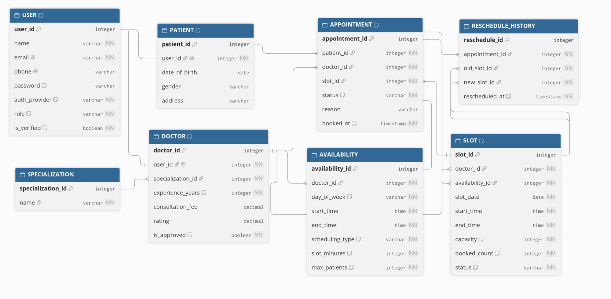

# Schedule Project ER diagram

Live diagram: <https://dbdiagram.io/embed#c=Ly8gU2NoZWR1bGUgUHJvamVjdAoKVGFibGUgVVNFUiB7CiAgdXNlcl9pZCBpbnRlZ2VyIFtwcmltYXJ5IGtleSwgaW5jcmVtZW50XQogIG5hbWUgdmFyY2hhciBbbm90IG51bGxdCiAgZW1haWwgdmFyY2hhciBbbm90IG51bGwsIHVuaXF1ZV0KICBwaG9uZSB2YXJjaGFyIFt1bmlxdWVdCiAgcGFzc3dvcmQgdmFyY2hhciBbbm90ZTogJ0VtcHR5IHdoZW4gYXV0aF9wcm92aWRlciBpcyBnb29nbGUnXQogIGF1dGhfcHJvdmlkZXIgdmFyY2hhciBbbm90IG51bGwsIG5vdGU6ICdlbWFpbCB8IHBob25lIHwgZ29vZ2xlJ10KICByb2xlIHZhcmNoYXIgW25vdCBudWxsLCBub3RlOiAncGF0aWVudCB8IGRvY3RvciddCiAgaXNfdmVyaWZpZWQgYm9vbGVhbiBbbm90IG51bGwsIGRlZmF1bHQ6IGZhbHNlXQoKICBOb3RlOiAnTG9naW4gYWNjb3VudC4gQSBwYXRpZW50IGlzIGEgdXNlciB3aXRoIHJvbGUgPSBwYXRpZW50LicKfQoKVGFibGUgUEFUSUVOVCB7CiAgcGF0aWVudF9pZCBpbnRlZ2VyIFtwcmltYXJ5IGtleSwgaW5jcmVtZW50XQogIHVzZXJfaWQgaW50ZWdlciBbbm90IG51bGwsIHVuaXF1ZSwgcmVmOiAtIFVTRVIudXNlcl9pZF0KICBkYXRlX29mX2JpcnRoIGRhdGUKICBnZW5kZXIgdmFyY2hhcgogIGFkZHJlc3MgdmFyY2hhcgoKICBOb3RlOiAnUHJvZmlsZSBmb3IgYSB1c2VyIHdob3NlIHJvbGUgaXMgcGF0aWVudC4gT25lIHVzZXIsIG9uZSBwYXRpZW50IHJvdy4nCn0KClRhYmxlIFNQRUNJQUxJWkFUSU9OIHsKICBzcGVjaWFsaXphdGlvbl9pZCBpbnRlZ2VyIFtwcmltYXJ5IGtleSwgaW5jcmVtZW50XQogIG5hbWUgdmFyY2hhciBbbm90IG51bGwsIHVuaXF1ZV0KfQoKVGFibGUgRE9DVE9SIHsKICBkb2N0b3JfaWQgaW50ZWdlciBbcHJpbWFyeSBrZXksIGluY3JlbWVudF0KICB1c2VyX2lkIGludGVnZXIgW25vdCBudWxsLCB1bmlxdWUsIHJlZjogLSBVU0VSLnVzZXJfaWRdCiAgc3BlY2lhbGl6YXRpb25faWQgaW50ZWdlciBbbm90IG51bGwsIHJlZjogPiBTUEVDSUFMSVpBVElPTi5zcGVjaWFsaXphdGlvbl9pZF0KICBleHBlcmllbmNlX3llYXJzIGludGVnZXIgW25vdCBudWxsLCBkZWZhdWx0OiAwXQogIGNvbnN1bHRhdGlvbl9mZWUgZGVjaW1hbAogIHJhdGluZyBkZWNpbWFsCiAgaXNfYXBwcm92ZWQgYm9vbGVhbiBbbm90IG51bGwsIGRlZmF1bHQ6IGZhbHNlXQoKICBOb3RlOiAnUHJvZmlsZSBmb3IgYSB1c2VyIHdob3NlIHJvbGUgaXMgZG9jdG9yLicKfQoKVGFibGUgQVZBSUxBQklMSVRZIHsKICBhdmFpbGFiaWxpdHlfaWQgaW50ZWdlciBbcHJpbWFyeSBrZXksIGluY3JlbWVudF0KICBkb2N0b3JfaWQgaW50ZWdlciBbbm90IG51bGwsIHJlZjogPiBET0NUT1IuZG9jdG9yX2lkXQogIGRheV9vZl93ZWVrIHZhcmNoYXIgW25vdCBudWxsLCBub3RlOiAnbW9uIHwgdHVlIHwgd2VkIHwgdGh1IHwgZnJpIHwgc2F0IHwgc3VuJ10KICBzdGFydF90aW1lIHRpbWUgW25vdCBudWxsXQogIGVuZF90aW1lIHRpbWUgW25vdCBudWxsXQogIHNjaGVkdWxpbmdfdHlwZSB2YXJjaGFyIFtub3QgbnVsbCwgbm90ZTogJ3dhdmUgfCBzdHJlYW0nXQogIHNsb3RfbWludXRlcyBpbnRlZ2VyIFtub3QgbnVsbCwgbm90ZTogJ1N0cmVhbSBnYXAsIGZvciBleGFtcGxlIDEwLiBXYXZlIHdpbmRvdyBsZW5ndGgsIGZvciBleGFtcGxlIDMwLiddCiAgbWF4X3BhdGllbnRzIGludGVnZXIgW25vdCBudWxsLCBkZWZhdWx0OiAxLCBub3RlOiAnV2F2ZSBjYXBhY2l0eS4gU3RyZWFtIGlzIDEuIEVsYXN0aWMgc2NoZWR1bGluZyByYWlzZXMgdGhpcy4nXQp9CgpUYWJsZSBTTE9UIHsKICBzbG90X2lkIGludGVnZXIgW3ByaW1hcnkga2V5LCBpbmNyZW1lbnRdCiAgZG9jdG9yX2lkIGludGVnZXIgW25vdCBudWxsLCByZWY6ID4gRE9DVE9SLmRvY3Rvcl9pZF0KICBhdmFpbGFiaWxpdHlfaWQgaW50ZWdlciBbbm90IG51bGwsIHJlZjogPiBBVkFJTEFCSUxJVFkuYXZhaWxhYmlsaXR5X2lkXQogIHNsb3RfZGF0ZSBkYXRlIFtub3QgbnVsbF0KICBzdGFydF90aW1lIHRpbWUgW25vdCBudWxsXQogIGVuZF90aW1lIHRpbWUgW25vdCBudWxsXQogIGNhcGFjaXR5IGludGVnZXIgW25vdCBudWxsLCBub3RlOiAnV2F2ZTogbWFueSBwYXRpZW50cy4gU3RyZWFtOiAxLiBFbGFzdGljOiBkb2N0b3IgY2FuIHJhaXNlIHRoaXMuJ10KICBib29rZWRfY291bnQgaW50ZWdlciBbbm90IG51bGwsIGRlZmF1bHQ6IDBdCiAgc3RhdHVzIHZhcmNoYXIgW25vdCBudWxsLCBkZWZhdWx0OiAnb3BlbicsIG5vdGU6ICdvcGVuIHwgZnVsbCB8IGJsb2NrZWQnXQoKICBpbmRleGVzIHsKICAgIChkb2N0b3JfaWQsIHNsb3RfZGF0ZSwgc3RhcnRfdGltZSkgW3VuaXF1ZV0KICB9Cn0KClRhYmxlIEFQUE9JTlRNRU5UIHsKICBhcHBvaW50bWVudF9pZCBpbnRlZ2VyIFtwcmltYXJ5IGtleSwgaW5jcmVtZW50XQogIHBhdGllbnRfaWQgaW50ZWdlciBbbm90IG51bGwsIHJlZjogPiBQQVRJRU5ULnBhdGllbnRfaWRdCiAgZG9jdG9yX2lkIGludGVnZXIgW25vdCBudWxsLCByZWY6ID4gRE9DVE9SLmRvY3Rvcl9pZF0KICBzbG90X2lkIGludGVnZXIgW25vdCBudWxsLCByZWY6ID4gU0xPVC5zbG90X2lkXQogIHN0YXR1cyB2YXJjaGFyIFtub3QgbnVsbCwgZGVmYXVsdDogJ2Jvb2tlZCcsIG5vdGU6ICdib29rZWQgfCBjb21wbGV0ZWQgfCBjYW5jZWxsZWQnXQogIHJlYXNvbiB2YXJjaGFyCiAgYm9va2VkX2F0IHRpbWVzdGFtcCBbbm90IG51bGwsIGRlZmF1bHQ6IGBub3coKWBdCgogIGluZGV4ZXMgewogICAgKHBhdGllbnRfaWQsIHNsb3RfaWQpIFt1bmlxdWUsIG5vdGU6ICdBIHBhdGllbnQgYm9va3MgYSBzbG90IG9ubHkgb25jZSddCiAgfQp9CgpUYWJsZSBSRVNDSEVEVUxFX0hJU1RPUlkgewogIHJlc2NoZWR1bGVfaWQgaW50ZWdlciBbcHJpbWFyeSBrZXksIGluY3JlbWVudF0KICBhcHBvaW50bWVudF9pZCBpbnRlZ2VyIFtub3QgbnVsbCwgcmVmOiA%2BIEFQUE9JTlRNRU5ULmFwcG9pbnRtZW50X2lkXQogIG9sZF9zbG90X2lkIGludGVnZXIgW25vdCBudWxsLCByZWY6ID4gU0xPVC5zbG90X2lkXQogIG5ld19zbG90X2lkIGludGVnZXIgW25vdCBudWxsLCByZWY6ID4gU0xPVC5zbG90X2lkXQogIHJlc2NoZWR1bGVkX2F0IHRpbWVzdGFtcCBbbm90IG51bGwsIGRlZmF1bHQ6IGBub3coKWBdCn0%3D>

DBML source: [schema.dbml](schema.dbml)

Modules, in order: User, Patient, Doctor, Availability, Appointment.

A patient is a user with `role = patient`. A doctor is a user with `role = doctor`. Each login has one profile row.
